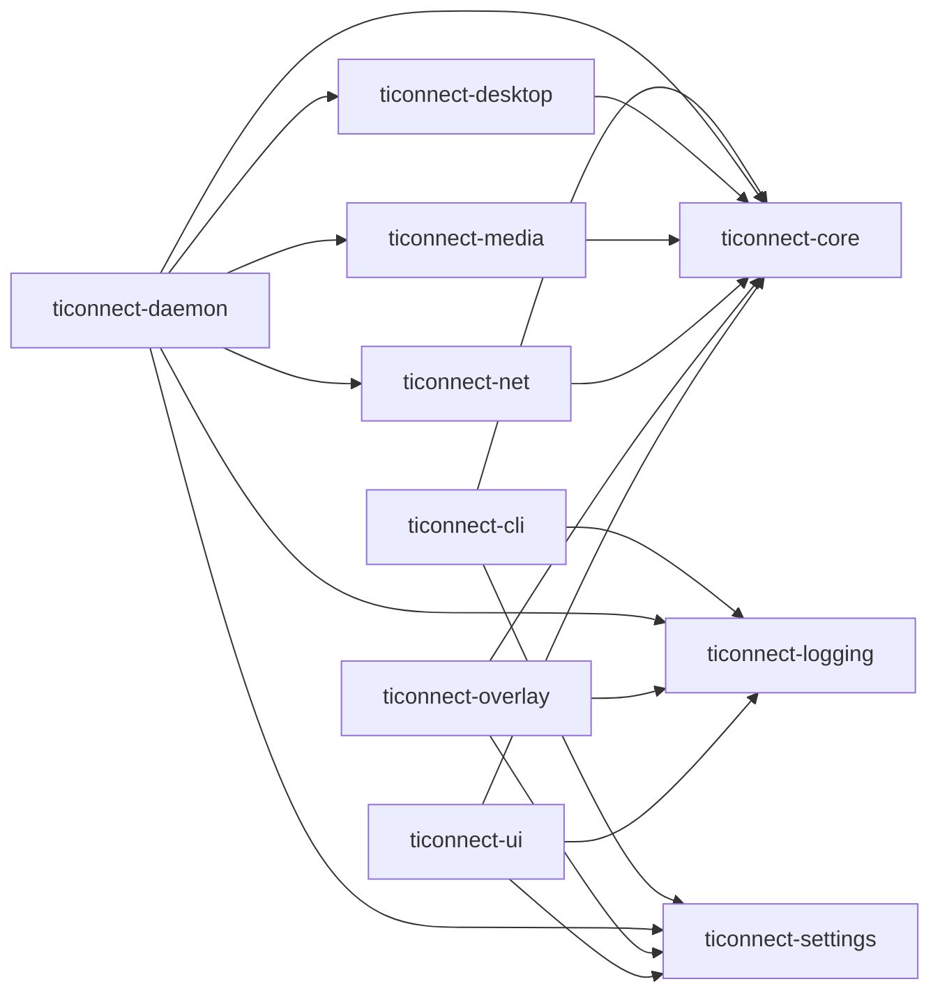

<!-- generated by cargo xtask systems. edit docs/systems/graph/ or docs/systems/state-machines.toml instead. -->

# Build dependency graph

Generated from `docs/systems/graph/` and checked against `cargo metadata`.

| From | To |
|---|---|
| `ticonnect-cli` | `ticonnect-core` |
| `ticonnect-cli` | `ticonnect-logging` |
| `ticonnect-cli` | `ticonnect-settings` |
| `ticonnect-daemon` | `ticonnect-core` |
| `ticonnect-daemon` | `ticonnect-desktop` |
| `ticonnect-daemon` | `ticonnect-logging` |
| `ticonnect-daemon` | `ticonnect-media` |
| `ticonnect-daemon` | `ticonnect-net` |
| `ticonnect-daemon` | `ticonnect-settings` |
| `ticonnect-desktop` | `ticonnect-core` |
| `ticonnect-media` | `ticonnect-core` |
| `ticonnect-net` | `ticonnect-core` |
| `ticonnect-overlay` | `ticonnect-core` |
| `ticonnect-overlay` | `ticonnect-logging` |
| `ticonnect-overlay` | `ticonnect-settings` |
| `ticonnect-ui` | `ticonnect-core` |
| `ticonnect-ui` | `ticonnect-logging` |
| `ticonnect-ui` | `ticonnect-settings` |

## Build rules

| Rule | Packages | Forbidden | Forbidden prefix |
|---|---|---|---|
| `core-no-up` | ticonnect-core | ticonnect-settings, ticonnect-logging |  |
| `leaves-are-leaves` | ticonnect-settings, ticonnect-logging |  | ticonnect- |
| `clients-no-internals` | ticonnect-ui, ticonnect-overlay, ticonnect-cli | ticonnect-daemon, ticonnect-net, ticonnect-media, ticonnect-desktop |  |
| `services-no-daemon` | ticonnect-net, ticonnect-media, ticonnect-desktop | ticonnect-daemon |  |
