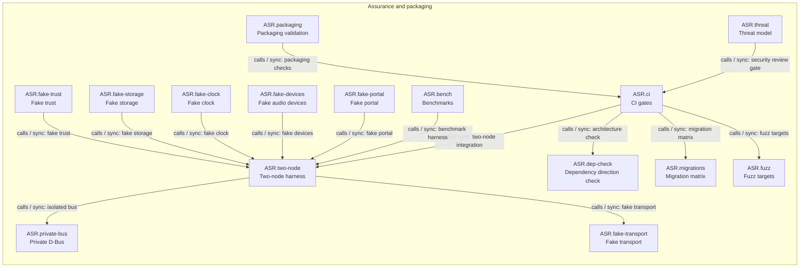

<!-- generated by cargo xtask systems. edit docs/systems/graph/ or docs/systems/state-machines.toml instead. -->

# Assurance and packaging component graph

Back to [Assurance and packaging](../../24-assurance.md) and [registry](../registry.md).

| From | Kind | Mode | To | Contract | Gate | Limit | Stage |
|---|---|---|---|---|---|---|---|
| `ASR.two-node` | calls | sync | `ASR.private-bus` | isolated bus |  |  | 1 |
| `ASR.two-node` | calls | sync | `ASR.fake-transport` | fake transport |  |  | 1 |
| `ASR.ci` | calls | sync | `ASR.dep-check` | architecture check |  |  | 1 |
| `ASR.ci` | calls | sync | `ASR.migrations` | migration matrix |  |  | 3 |
| `ASR.ci` | calls | sync | `ASR.fuzz` | fuzz targets |  |  | 5 |
| `ASR.ci` | calls | sync | `ASR.two-node` | two-node integration |  |  | 1 |
| `ASR.bench` | calls | sync | `ASR.two-node` | benchmark harness |  |  | 12 |
| `ASR.fake-portal` | calls | sync | `ASR.two-node` | fake portal |  |  | 1 |
| `ASR.fake-devices` | calls | sync | `ASR.two-node` | fake devices |  |  | 1 |
| `ASR.fake-clock` | calls | sync | `ASR.two-node` | fake clock |  |  | 1 |
| `ASR.fake-storage` | calls | sync | `ASR.two-node` | fake storage |  |  | 1 |
| `ASR.fake-trust` | calls | sync | `ASR.two-node` | fake trust |  |  | 1 |
| `ASR.threat` | calls | sync | `ASR.ci` | security review gate |  |  | 5 |
| `ASR.packaging` | calls | sync | `ASR.ci` | packaging checks |  |  | 12 |
