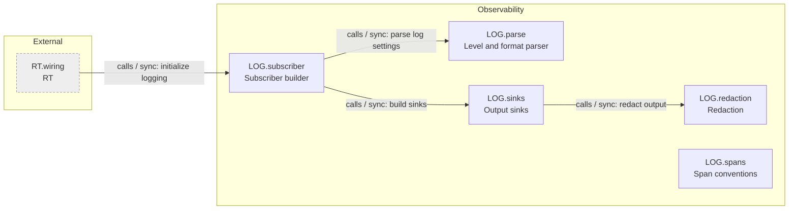

<!-- generated by cargo xtask systems. edit docs/systems/graph/ or docs/systems/state-machines.toml instead. -->

# Observability component graph

Back to [Observability](../../03-observability.md) and [registry](../registry.md).

| From | Kind | Mode | To | Contract | Gate | Limit | Stage |
|---|---|---|---|---|---|---|---|
| `RT.wiring` | calls | sync | `LOG.subscriber` | initialize logging |  |  | 2 |
| `LOG.subscriber` | calls | sync | `LOG.parse` | parse log settings |  |  | 1 |
| `LOG.subscriber` | calls | sync | `LOG.sinks` | build sinks |  |  | 1 |
| `LOG.sinks` | calls | sync | `LOG.redaction` | redact output |  |  | 1 |
