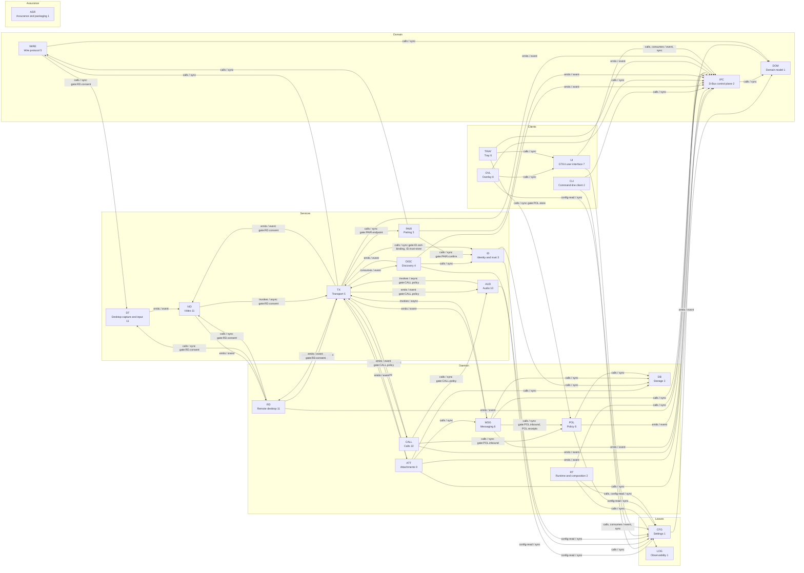

<!-- generated by cargo xtask systems. edit docs/systems/graph/ or docs/systems/state-machines.toml instead. -->

# Runtime graph

Cross-system runtime edges. Build-time dependencies live in [build-deps](build-deps.md).

## Cross-system component edges

| From | To | Kind | Mode | Contract | Gate | Limit | Stage |
|---|---|---|---|---|---|---|---|
| `RT.wiring` | `CFG.file-store` | calls | sync | load settings |  |  | 2 |
| `RT.wiring` | `LOG.subscriber` | calls | sync | initialize logging |  |  | 2 |
| `RT.wiring` | `IPC.dispatch` | calls | sync | compose daemon service |  |  | 2 |
| `RT.autostart` | `CFG.file-store` | config-read | sync | autostart setting |  |  | 2 |
| `CFG.watch` | `IPC.signal-bus` | emits | event | SettingsChanged |  |  | 3 |
| `IPC.dto` | `DOM.ids` | calls | sync | domain id mapping |  |  | 2 |
| `ID.trust-store` | `DB.peers` | calls | sync | trusted peer rows |  |  | 5 |
| `ID.key-load` | `CFG.file-store` | config-read | sync | config directory |  |  | 3 |
| `DISC.supervisor` | `IPC.signal-bus` | emits | event | CandidateFound and CandidateLost |  |  | 4 |
| `DISC.candidates` | `TX.dialer` | emits | event | candidate available |  |  | 5 |
| `DISC.supervisor` | `ID.fingerprint` | calls | sync | advertise fingerprint |  |  | 4 |
| `DISC.supervisor` | `CFG.file-store` | config-read | sync | discovery settings |  |  | 4 |
| `PAIR.commit` | `ID.trust-store` | calls | sync | commit trusted peer | PAIR.confirm |  | 5 |
| `PAIR.commit` | `IPC.signal-bus` | emits | event | PairingCompleted or PairingFailed |  |  | 5 |
| `PAIR.endpoint` | `WIRE.envelope` | calls | sync | pairing frame envelope |  |  | 5 |
| `PAIR.qr` | `ID.fingerprint` | calls | sync | QR fingerprint |  |  | 5 |
| `TX.dialer` | `DISC.candidates` | consumes | event | candidate available |  |  | 5 |
| `TX.verifier` | `ID.trust-store` | calls | sync | pinned trust lookup | ID.trust-store |  | 5 |
| `TX.tls-cert` | `ID.cert-binding` | calls | sync | certificate binding | ID.cert-binding |  | 5 |
| `TX.alpn` | `PAIR.endpoint` | calls | sync | pairing ALPN | PAIR.endpoint |  | 5 |
| `TX.streams` | `WIRE.envelope` | calls | sync | stream frames |  |  | 5 |
| `TX.datagrams` | `WIRE.envelope` | calls | sync | datagram frames |  |  | 5 |
| `TX.session` | `IPC.signal-bus` | emits | event | PeerConnected and PeerDisconnected |  |  | 5 |
| `TX.session` | `MSG.sync-executor` | emits | event | session established |  |  | 6 |
| `TX.session` | `ATT.scheduler` | emits | event | transfer stream available |  |  | 9 |
| `TX.session` | `CALL.signaling` | emits | event | call signaling available | CALL.policy |  | 10 |
| `TX.session` | `RD.transport` | emits | event | remote session transport available | RD.consent |  | 11 |
| `TX.datagrams` | `AUD.decode` | emits | event | audio datagram | CALL.policy |  | 10 |
| `WIRE.message` | `DOM.message` | calls | sync | decode message record |  |  | 6 |
| `WIRE.ack` | `DOM.ack` | calls | sync | decode ack record |  |  | 6 |
| `WIRE.transfer` | `DOM.attachment-ref` | calls | sync | attachment reference |  |  | 9 |
| `WIRE.input` | `DT.validate` | calls | sync | input validation | RD.consent |  | 11 |
| `MSG.conversation` | `DOM.ids` | calls | sync | conversation id |  |  | 6 |
| `MSG.signer` | `DOM.message` | calls | sync | sign message record |  |  | 6 |
| `MSG.verifier` | `DOM.message` | calls | sync | verify message record |  |  | 6 |
| `MSG.ingest` | `POL.inbound` | calls | sync | inbound policy decision | POL.inbound |  | 6 |
| `MSG.ingest` | `DB.messages` | calls | sync | insert message |  |  | 6 |
| `MSG.history` | `DB.messages` | calls | sync | list messages |  |  | 6 |
| `MSG.outbox` | `DB.outbox` | calls | sync | queue outbound record |  |  | 6 |
| `MSG.outbox` | `TX.streams` | invokes | async | send message frame |  |  | 6 |
| `MSG.sync-planner` | `DB.peer-state` | calls | sync | read peer state |  |  | 6 |
| `MSG.sync-executor` | `TX.streams` | invokes | async | request missing records |  |  | 6 |
| `MSG.sync-executor` | `DB.messages` | calls | sync | insert synced records |  |  | 6 |
| `MSG.state` | `DB.messages` | calls | sync | read message state |  |  | 6 |
| `MSG.events` | `IPC.signal-bus` | emits | event | MessageReceived and MessageStateChanged |  |  | 6 |
| `MSG.receipts` | `POL.receipts` | calls | sync | receipt suppression | POL.receipts |  | 6 |
| `MSG.ingest` | `DB.peer-state` | calls | sync | update last_recv_seq |  |  | 6 |
| `POL.store` | `DB.peers` | calls | sync | peer policy rows |  |  | 6 |
| `POL.dnd` | `CFG.file-store` | config-read | sync | DND setting |  |  | 6 |
| `POL.notify` | `IPC.signal-bus` | emits | event | notification event |  |  | 6 |
| `POL.store` | `IPC.signal-bus` | emits | event | PolicyChanged |  |  | 6 |
| `ATT.store` | `DOM.attachment-ref` | calls | sync | attachment reference |  |  | 9 |
| `ATT.resume` | `DB.transfer-partials` | calls | sync | partial transfer state |  |  | 9 |
| `ATT.scheduler` | `TX.streams` | invokes | async | open transfer stream |  |  | 9 |
| `ATT.link` | `MSG.ingest` | calls | sync | attachment message |  |  | 9 |
| `ATT.progress` | `IPC.signal-bus` | emits | event | TransferProgress and TransferDone |  |  | 9 |
| `ATT.recv-verify` | `DB.attachments` | calls | sync | attachment metadata |  |  | 9 |
| `AUD.encode` | `TX.datagrams` | invokes | async | send audio datagram | CALL.policy |  | 10 |
| `AUD.ringtone` | `CFG.file-store` | config-read | sync | ringtone path |  |  | 10 |
| `CALL.signaling` | `TX.streams` | invokes | async | call signaling frame |  |  | 10 |
| `CALL.signaling` | `TX.datagrams` | invokes | async | call control datagram |  |  | 10 |
| `CALL.media` | `AUD.devices` | calls | sync | audio devices | CALL.policy |  | 10 |
| `CALL.media` | `AUD.encode` | calls | sync | encode call audio |  |  | 10 |
| `CALL.media` | `AUD.decode` | calls | sync | decode call audio |  |  | 10 |
| `CALL.ringtone` | `AUD.ringtone` | calls | sync | ringtone playback |  |  | 10 |
| `CALL.state` | `IPC.signal-bus` | emits | event | IncomingCall and CallStateChanged |  |  | 10 |
| `CALL.policy` | `POL.inbound` | calls | sync | call policy decision | POL.inbound |  | 10 |
| `CALL.cleanup` | `AUD.devices` | calls | sync | release audio devices |  |  | 10 |
| `CALL.cleanup` | `TX.session` | calls | sync | close call transport |  |  | 10 |
| `DT.capture` | `VID.encoder` | emits | event | captured frame |  |  | 11 |
| `VID.packetize` | `TX.streams` | invokes | async | send video frame | RD.consent |  | 11 |
| `TX.streams` | `VID.decoder` | emits | event | received video frame | RD.consent |  | 11 |
| `VID.decoder` | `RD.transport` | emits | event | decoded frame |  |  | 11 |
| `RD.consent` | `IPC.signal-bus` | emits | event | RemoteSessionRequested |  |  | 11 |
| `RD.state` | `IPC.signal-bus` | emits | event | RemoteSessionStarted and RemoteSessionEnded |  |  | 11 |
| `RD.capture` | `DT.portal` | calls | sync | open portal session | RD.consent |  | 11 |
| `RD.capture` | `DT.capture` | calls | sync | start capture | RD.consent |  | 11 |
| `RD.capture` | `VID.encoder` | calls | sync | encode capture | RD.consent |  | 11 |
| `RD.input` | `DT.input-router` | calls | sync | inject input | RD.consent |  | 11 |
| `RD.transport` | `TX.streams` | invokes | async | remote frame stream | RD.consent |  | 11 |
| `RD.transport` | `TX.datagrams` | invokes | async | remote input datagram | RD.consent |  | 11 |
| `RD.teardown` | `DT.portal` | calls | sync | close portal session |  |  | 11 |
| `RD.teardown` | `TX.session` | calls | sync | close remote transport |  |  | 11 |
| `RD.indicator` | `IPC.signal-bus` | emits | event | indicator visibility |  |  | 11 |
| `UI.client` | `IPC.client` | calls | sync | daemon proxy |  |  | 7 |
| `UI.settings` | `CFG.file-store` | calls | sync | direct settings write |  |  | 7 |
| `UI.client` | `IPC.signal-bus` | consumes | event | daemon signals |  |  | 7 |
| `UI.settings` | `CFG.watch` | consumes | event | SettingsChanged |  |  | 7 |
| `OVL.client` | `IPC.client` | calls | sync | daemon signal proxy |  |  | 8 |
| `OVL.activate` | `UI.activate` | calls | sync | Activate view |  |  | 8 |
| `OVL.client` | `CFG.file-store` | config-read | sync | overlay enabled |  |  | 8 |
| `TRAY.policy` | `POL.store` | calls | sync | set peer policy | POL.store |  | 6 |
| `TRAY.activate` | `UI.activate` | calls | sync | Activate view |  |  | 6 |
| `TRAY.item` | `IPC.signal-bus` | emits | event | tray status |  |  | 6 |
| `CLI.daemon` | `IPC.client` | calls | sync | daemon proxy |  |  | 2 |
| `CLI.settings` | `CFG.file-store` | calls | sync | settings read and write |  |  | 3 |
