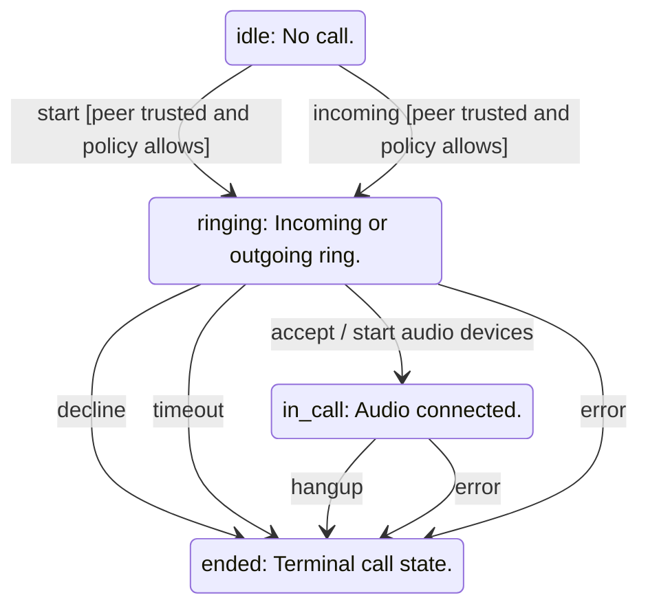

<!-- generated by cargo xtask systems. edit docs/systems/graph/ or docs/systems/state-machines.toml instead. -->

# call state machine

- Owner: `CALL.state`
- Contract: `16-calls.md`

| From | Event | To | Guard | Action |
|---|---|---|---|---|
| `idle` | start | `ringing` | peer trusted and policy allows |  |
| `idle` | incoming | `ringing` | peer trusted and policy allows |  |
| `ringing` | accept | `in_call` |  | start audio devices |
| `ringing` | decline | `ended` |  |  |
| `ringing` | timeout | `ended` |  |  |
| `in_call` | hangup | `ended` |  |  |
| `in_call` | error | `ended` |  |  |
| `ringing` | error | `ended` |  |  |
