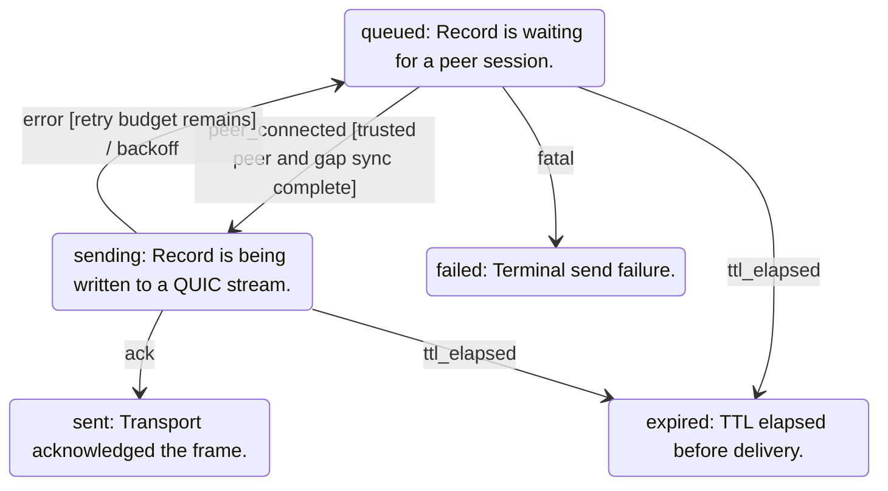

<!-- generated by cargo xtask systems. edit docs/systems/graph/ or docs/systems/state-machines.toml instead. -->

# outbox state machine

- Owner: `MSG.outbox`
- Contract: `12-messaging.md`

| From | Event | To | Guard | Action |
|---|---|---|---|---|
| `queued` | peer_connected | `sending` | trusted peer and gap sync complete |  |
| `sending` | ack | `sent` |  |  |
| `sending` | error | `queued` | retry budget remains | backoff |
| `queued` | ttl_elapsed | `expired` |  |  |
| `sending` | ttl_elapsed | `expired` |  |  |
| `queued` | fatal | `failed` |  |  |
