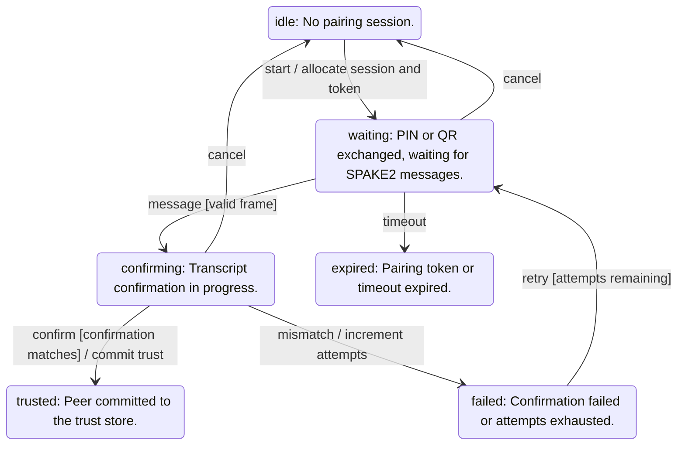

<!-- generated by cargo xtask systems. edit docs/systems/graph/ or docs/systems/state-machines.toml instead. -->

# pairing state machine

- Owner: `PAIR.spake2`
- Contract: `09-pairing.md`

| From | Event | To | Guard | Action |
|---|---|---|---|---|
| `idle` | start | `waiting` |  | allocate session and token |
| `waiting` | message | `confirming` | valid frame |  |
| `confirming` | confirm | `trusted` | confirmation matches | commit trust |
| `confirming` | mismatch | `failed` |  | increment attempts |
| `waiting` | timeout | `expired` |  |  |
| `waiting` | cancel | `idle` |  |  |
| `confirming` | cancel | `idle` |  |  |
| `failed` | retry | `waiting` | attempts remaining |  |
