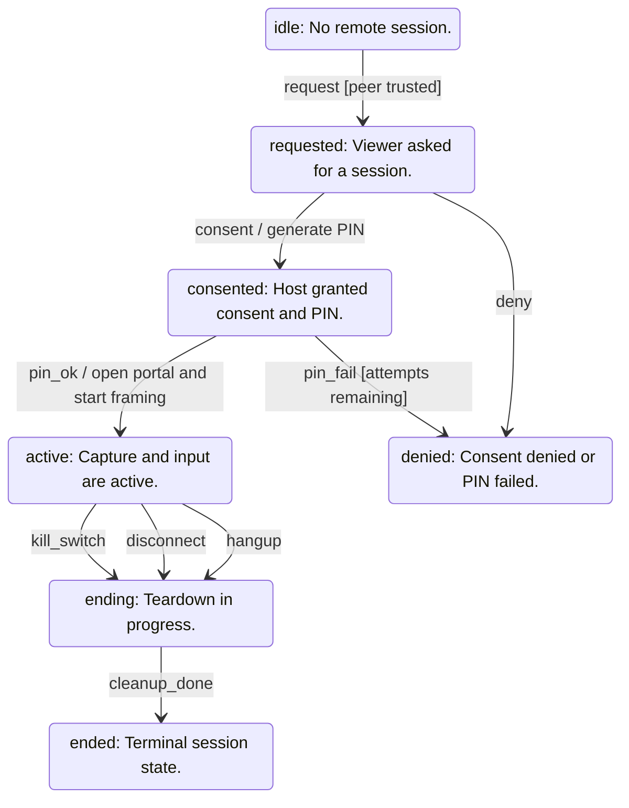

<!-- generated by cargo xtask systems. edit docs/systems/graph/ or docs/systems/state-machines.toml instead. -->

# remote state machine

- Owner: `RD.state`
- Contract: `19-remote-desktop.md`

| From | Event | To | Guard | Action |
|---|---|---|---|---|
| `idle` | request | `requested` | peer trusted |  |
| `requested` | consent | `consented` |  | generate PIN |
| `requested` | deny | `denied` |  |  |
| `consented` | pin_ok | `active` |  | open portal and start framing |
| `consented` | pin_fail | `denied` | attempts remaining |  |
| `active` | kill_switch | `ending` |  |  |
| `active` | disconnect | `ending` |  |  |
| `active` | hangup | `ending` |  |  |
| `ending` | cleanup_done | `ended` |  |  |
