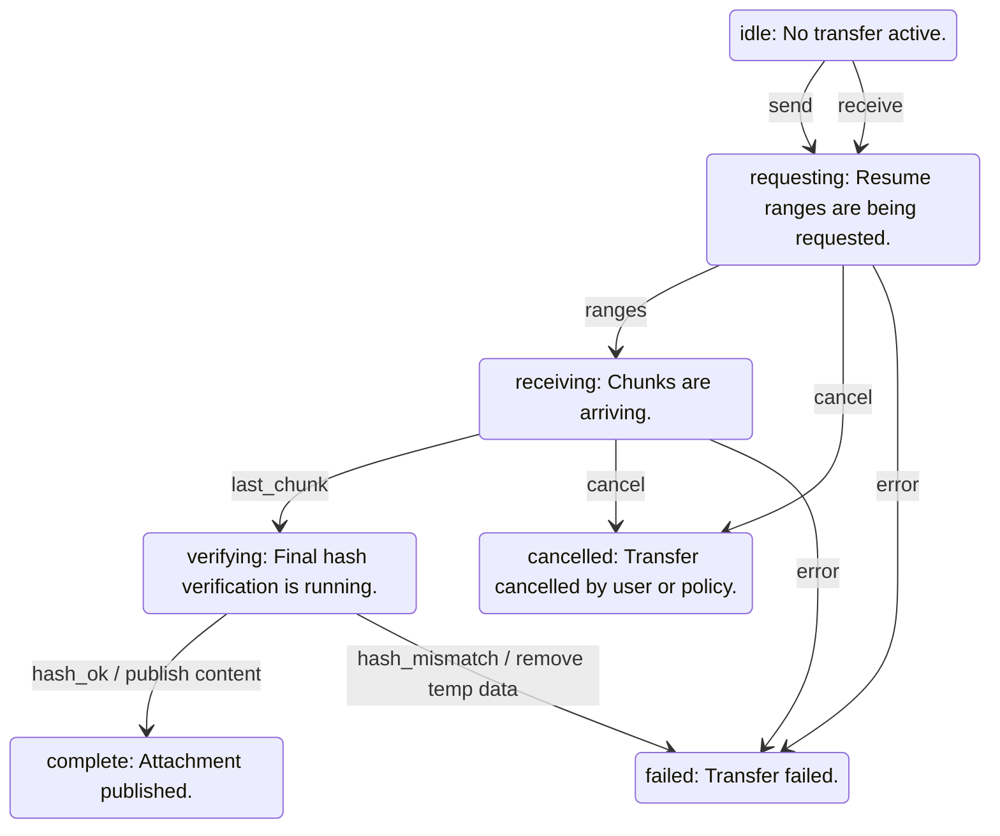

<!-- generated by cargo xtask systems. edit docs/systems/graph/ or docs/systems/state-machines.toml instead. -->

# transfer state machine

- Owner: `ATT.scheduler`
- Contract: `14-attachments.md`

| From | Event | To | Guard | Action |
|---|---|---|---|---|
| `idle` | send | `requesting` |  |  |
| `idle` | receive | `requesting` |  |  |
| `requesting` | ranges | `receiving` |  |  |
| `receiving` | last_chunk | `verifying` |  |  |
| `verifying` | hash_ok | `complete` |  | publish content |
| `verifying` | hash_mismatch | `failed` |  | remove temp data |
| `requesting` | cancel | `cancelled` |  |  |
| `receiving` | cancel | `cancelled` |  |  |
| `requesting` | error | `failed` |  |  |
| `receiving` | error | `failed` |  |  |
