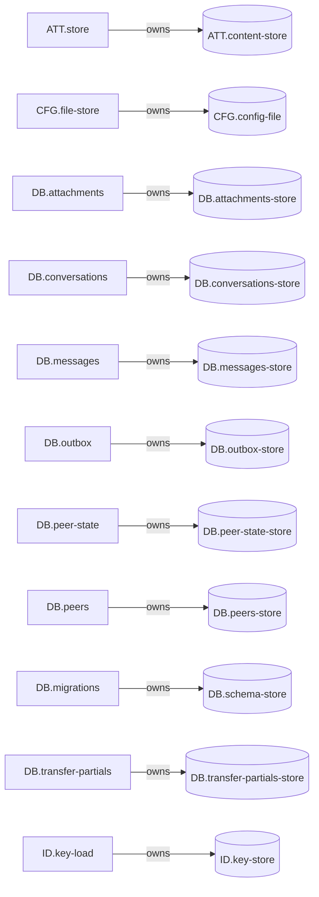

<!-- generated by cargo xtask systems. edit docs/systems/graph/ or docs/systems/state-machines.toml instead. -->

# State ownership

| Store | Kind | Owner | Path |
|---|---|---|---|
| `ATT.content-store` | content-directory | `ATT.store` | $XDG_DATA_HOME/ticonnect/attachments |
| `CFG.config-file` | toml-file | `CFG.file-store` | $XDG_CONFIG_HOME/ticonnect/config.toml |
| `DB.attachments-store` | sqlite-table | `DB.attachments` | $XDG_DATA_HOME/ticonnect/ticonnect.db#attachments |
| `DB.conversations-store` | sqlite-table | `DB.conversations` | $XDG_DATA_HOME/ticonnect/ticonnect.db#conversations |
| `DB.messages-store` | sqlite-table | `DB.messages` | $XDG_DATA_HOME/ticonnect/ticonnect.db#messages |
| `DB.outbox-store` | sqlite-table | `DB.outbox` | $XDG_DATA_HOME/ticonnect/ticonnect.db#outbox |
| `DB.peer-state-store` | sqlite-table | `DB.peer-state` | $XDG_DATA_HOME/ticonnect/ticonnect.db#peer_state |
| `DB.peers-store` | sqlite-table | `DB.peers` | $XDG_DATA_HOME/ticonnect/ticonnect.db#peers |
| `DB.schema-store` | sqlite-table | `DB.migrations` | $XDG_DATA_HOME/ticonnect/ticonnect.db#schema_version |
| `DB.transfer-partials-store` | sqlite-table | `DB.transfer-partials` | $XDG_DATA_HOME/ticonnect/ticonnect.db#transfer_partials |
| `ID.key-store` | key-file | `ID.key-load` | $XDG_CONFIG_HOME/ticonnect/identity.key |
