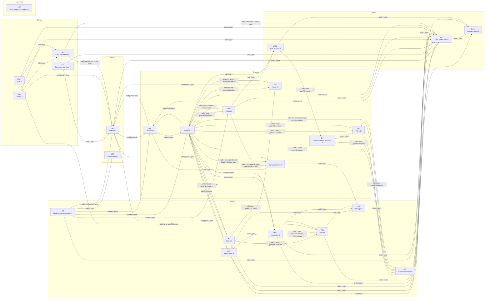

<!-- generated by cargo xtask systems. edit docs/systems/graph/ or docs/systems/state-machines.toml instead. -->

# System graph

## Aggregated system edges

| From | To | Kinds | Modes | Gates | Edges |
|---|---|---|---|---|---|
| `ATT` | `DB` | calls | sync |  | 2 |
| `ATT` | `DOM` | calls | sync |  | 1 |
| `ATT` | `IPC` | emits | event |  | 1 |
| `ATT` | `MSG` | calls | sync |  | 1 |
| `ATT` | `TX` | invokes | async |  | 1 |
| `AUD` | `CFG` | config-read | sync |  | 1 |
| `AUD` | `TX` | invokes | async | CALL.policy | 1 |
| `CALL` | `AUD` | calls | sync | CALL.policy | 5 |
| `CALL` | `IPC` | emits | event |  | 1 |
| `CALL` | `POL` | calls | sync | POL.inbound | 1 |
| `CALL` | `TX` | calls, invokes | async, sync |  | 3 |
| `CFG` | `DISC` | invokes | async |  | 1 |
| `CFG` | `IPC` | emits | event |  | 1 |
| `CLI` | `CFG` | calls | sync |  | 1 |
| `CLI` | `IPC` | calls | sync |  | 1 |
| `DISC` | `CFG` | config-read | sync |  | 1 |
| `DISC` | `ID` | calls | sync |  | 1 |
| `DISC` | `IPC` | emits | event |  | 1 |
| `DISC` | `TX` | emits | event |  | 1 |
| `DT` | `VID` | emits | event |  | 1 |
| `ID` | `CFG` | config-read | sync |  | 1 |
| `ID` | `DB` | calls | sync |  | 1 |
| `IPC` | `DOM` | calls | sync |  | 1 |
| `MSG` | `DB` | calls | sync |  | 7 |
| `MSG` | `DOM` | calls | sync |  | 3 |
| `MSG` | `IPC` | emits | event |  | 1 |
| `MSG` | `POL` | calls | sync | POL.inbound, POL.receipts | 2 |
| `MSG` | `TX` | invokes | async |  | 2 |
| `OVL` | `CFG` | config-read | sync |  | 1 |
| `OVL` | `IPC` | calls | sync |  | 1 |
| `OVL` | `UI` | calls | sync |  | 1 |
| `PAIR` | `ID` | calls | sync | ID.trust-store, PAIR.confirm | 3 |
| `PAIR` | `IPC` | emits | event |  | 2 |
| `PAIR` | `TX` | consumes, invokes | async, event |  | 2 |
| `PAIR` | `WIRE` | calls | sync |  | 1 |
| `POL` | `CFG` | config-read | sync |  | 1 |
| `POL` | `DB` | calls | sync |  | 1 |
| `POL` | `IPC` | emits | event |  | 2 |
| `RD` | `DT` | calls | sync | RD.consent | 4 |
| `RD` | `IPC` | emits | event |  | 3 |
| `RD` | `TX` | calls, invokes | async, sync | RD.consent | 3 |
| `RD` | `VID` | calls | sync | RD.consent | 1 |
| `RT` | `CFG` | calls, config-read | sync |  | 2 |
| `RT` | `DISC` | invokes | async |  | 1 |
| `RT` | `IPC` | calls | sync |  | 1 |
| `RT` | `LOG` | calls | sync |  | 1 |
| `RT` | `PAIR` | invokes | async |  | 1 |
| `RT` | `TX` | invokes | async |  | 1 |
| `TRAY` | `IPC` | emits | event |  | 1 |
| `TRAY` | `POL` | calls | sync | POL.store | 1 |
| `TRAY` | `UI` | calls | sync |  | 1 |
| `TX` | `ATT` | emits | event |  | 1 |
| `TX` | `AUD` | emits | event | CALL.policy | 1 |
| `TX` | `CALL` | emits | event | CALL.policy | 1 |
| `TX` | `DISC` | consumes | event |  | 1 |
| `TX` | `ID` | calls | sync | ID.cert-binding, ID.trust-store | 2 |
| `TX` | `IPC` | emits | event |  | 1 |
| `TX` | `MSG` | emits | event |  | 1 |
| `TX` | `PAIR` | calls | sync | PAIR.endpoint | 1 |
| `TX` | `RD` | emits | event | RD.consent | 1 |
| `TX` | `VID` | emits | event | RD.consent | 1 |
| `TX` | `WIRE` | calls | sync |  | 2 |
| `UI` | `CFG` | calls, consumes | event, sync |  | 2 |
| `UI` | `IPC` | calls, consumes | event, sync |  | 2 |
| `VID` | `RD` | emits | event |  | 1 |
| `VID` | `TX` | invokes | async | RD.consent | 1 |
| `WIRE` | `DOM` | calls | sync |  | 3 |
| `WIRE` | `DT` | calls | sync | RD.consent | 1 |
