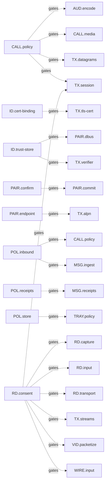

<!-- generated by cargo xtask systems. edit docs/systems/graph/ or docs/systems/state-machines.toml instead. -->

# Trust, policy, and consent gates

| Gate | From | To | Edge | Contract |
|---|---|---|---|---|
| `PAIR.confirm` | `PAIR.commit` | `ID.trust-store` | `E091` | commit trusted peer |
| `ID.trust-store` | `TX.verifier` | `ID.trust-store` | `E105` | pinned trust lookup |
| `ID.cert-binding` | `TX.tls-cert` | `ID.cert-binding` | `E106` | certificate binding |
| `PAIR.endpoint` | `TX.alpn` | `PAIR.endpoint` | `E107` | pairing ALPN |
| `CALL.policy` | `TX.session` | `CALL.signaling` | `E114` | call signaling available |
| `RD.consent` | `TX.session` | `RD.transport` | `E115` | remote session transport available |
| `CALL.policy` | `TX.datagrams` | `AUD.decode` | `E116` | audio datagram |
| `RD.consent` | `WIRE.input` | `DT.validate` | `E130` | input validation |
| `POL.inbound` | `MSG.ingest` | `POL.inbound` | `E136` | inbound policy decision |
| `POL.receipts` | `MSG.receipts` | `POL.receipts` | `E154` | receipt suppression |
| `CALL.policy` | `AUD.encode` | `TX.datagrams` | `E190` | send audio datagram |
| `CALL.policy` | `CALL.media` | `AUD.devices` | `E200` | audio devices |
| `POL.inbound` | `CALL.policy` | `POL.inbound` | `E205` | call policy decision |
| `RD.consent` | `VID.packetize` | `TX.streams` | `E224` | send video frame |
| `RD.consent` | `TX.streams` | `VID.decoder` | `E225` | received video frame |
| `RD.consent` | `RD.capture` | `DT.portal` | `E237` | open portal session |
| `RD.consent` | `RD.capture` | `DT.capture` | `E238` | start capture |
| `RD.consent` | `RD.capture` | `VID.encoder` | `E239` | encode capture |
| `RD.consent` | `RD.input` | `DT.input-router` | `E240` | inject input |
| `RD.consent` | `RD.transport` | `TX.streams` | `E241` | remote frame stream |
| `RD.consent` | `RD.transport` | `TX.datagrams` | `E242` | remote input datagram |
| `POL.store` | `TRAY.policy` | `POL.store` | `E279` | set peer policy |
| `ID.trust-store` | `PAIR.dbus` | `ID.trust-store` | `E308` | commit and forget peers |
